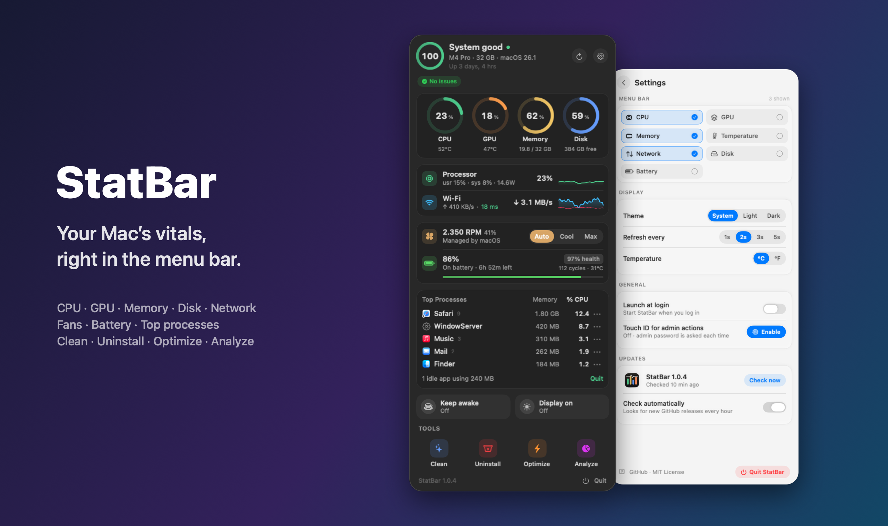
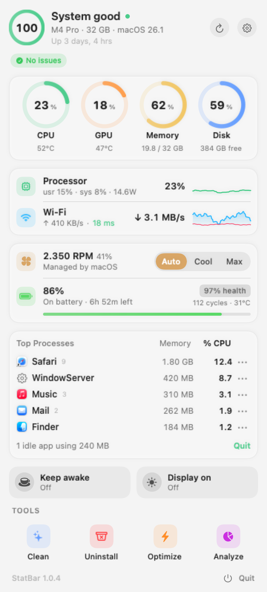
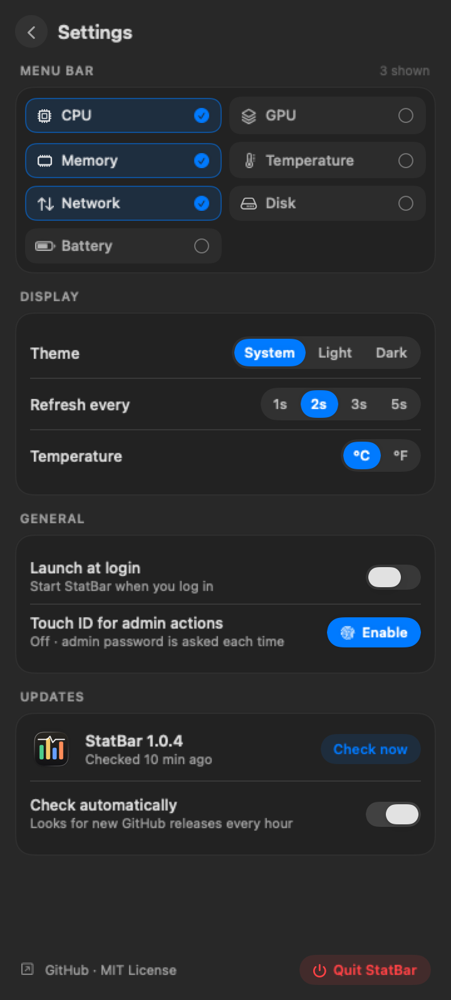
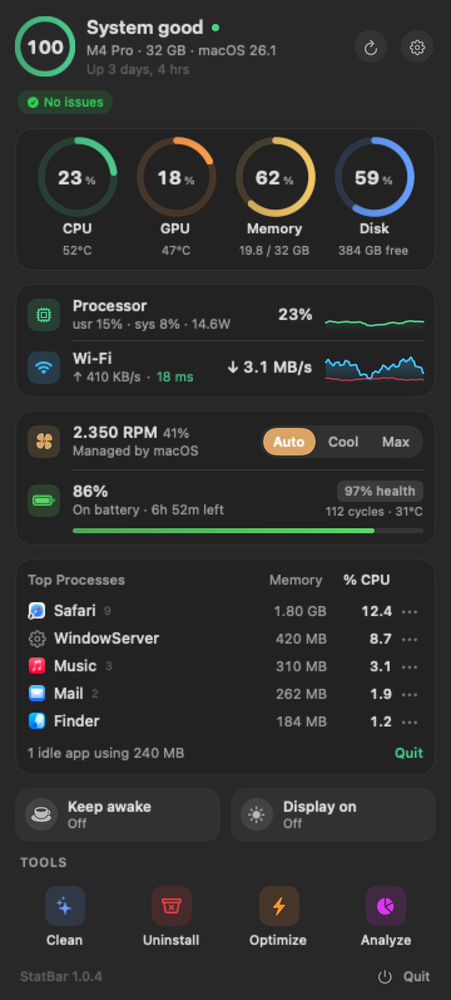

<div align="center">



# StatBar

**Your Mac’s vitals, right in the menu bar.**<br>
A tiny, native system monitor with a built-in toolbox to clean, uninstall and optimize.

[](https://github.com/nguyen-tien-thanh/statbar/releases/latest)
[](https://github.com/nguyen-tien-thanh/statbar/releases)
[](https://github.com/nguyen-tien-thanh/homebrew-tap)
[](#requirements)
[](#requirements)
[](Sources)
[](LICENSE)

[**Download**](https://github.com/nguyen-tien-thanh/statbar/releases/latest/download/StatBar.dmg) ·
[Install](#install) ·
[Features](#features) ·
[Build](#build-from-source)

</div>

---

## Install

### Homebrew (recommended)

```sh
brew install --cask nguyen-tien-thanh/tap/statbar
```

Homebrew 7+ asks you to trust third-party taps once: `brew trust --tap nguyen-tien-thanh/tap`.

### Manual

1. Download **[StatBar.dmg](https://github.com/nguyen-tien-thanh/statbar/releases/latest/download/StatBar.dmg)** and drag StatBar into **Applications**.
2. Open StatBar once and click **Done** on the macOS warning (StatBar isn’t notarized by Apple).
3. Open **Hướng dẫn cài đặt** in the DMG → **Mở Privacy & Security** → **Open Anyway**.<br>
   Or in Terminal: `xattr -cr /Applications/StatBar.app`

### Updates

StatBar checks GitHub Releases in the background. When a new version is out, click **Update** in the popover and it downloads, verifies (SHA-256 + code signature), swaps itself in place and relaunches.

## Features

<table>
<tr>
<td width="50%" valign="top">

**Monitor**
- Health score with the reasons behind it
- CPU, GPU, memory (with pressure), disk usage and I/O
- Network speed, Wi-Fi signal and latency
- Temperatures, fan speed and system power
- Battery: charge, health, cycles, adapter wattage
- Top processes by CPU or memory, quit / force quit
- Idle background apps you can close in one click
- Camera and microphone in-use indicators

</td>
<td width="50%" valign="top">

**Control**
- Pick what shows in the menu bar: CPU, GPU, memory, temperature, network, disk, battery
- Fan modes: Auto, Cool, Max (back to Auto on quit)
- Keep awake / keep the display on
- Optional Touch ID for admin actions
- Light, dark or system theme
- Launch at login

**Toolbox**
- **Clean** user caches, logs & crash reports, developer junk and the Trash
- **Uninstall** apps together with their files
- **Optimize**: free up RAM, flush DNS, rebuild Launch Services / Spotlight, reset Quick Look
- **Analyze** disk usage with a treemap

</td>
</tr>
</table>

<div align="center">



</div>

## Requirements

- macOS 13 Ventura or later
- Apple Silicon or Intel (universal binary, ~2 MB)

## Build from source

```sh
./build.sh                    # universal → build/StatBar.app, StatBar.dmg, StatBar.zip
ARCH=arm64 ./build.sh         # Apple Silicon only, faster
VERSION=1.2.3 ./build.sh      # override the version from Resources/Info.plist
```

Needs the Xcode Command Line Tools. No third-party dependencies.

| Path | What |
| --- | --- |
| `Sources/` | Swift app: samplers, monitor model, SwiftUI views, updater |
| `Bridge/smc.c` | SMC reader/writer (temperatures, fans, power) |
| `Helper/helper.c` | Privileged helper for fan control and admin actions |
| `scripts/` | App icon and DMG background generators |
| `Resources/Install.html` | Install guide shipped in the DMG |
| `docs/` | README images (`StatBar --readme-shots docs` renders them with demo data) |

Debug flags: `--snapshot out.png` renders the popover, `--selftest` runs the toolbox scanners read-only.

## Releasing

```sh
git tag v1.2.3 && git push origin v1.2.3
```

GitHub Actions builds the universal DMG and ZIP with the tag’s version, publishes the release and bumps the [Homebrew cask](https://github.com/nguyen-tien-thanh/homebrew-tap). Installed copies offer the update from the popover.

## License

[MIT](LICENSE) © Nguyen Tien Thanh
